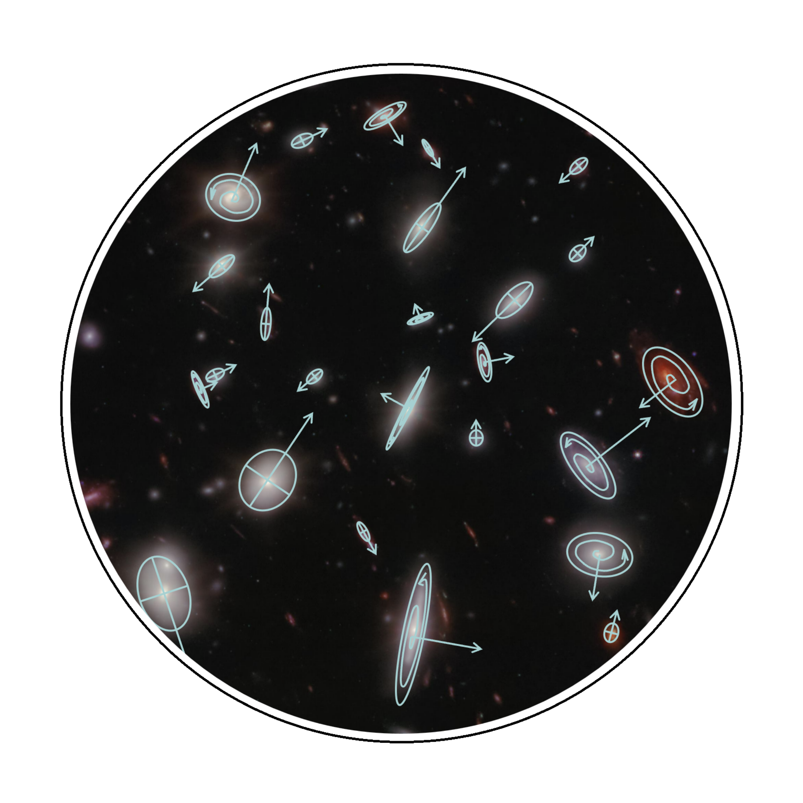
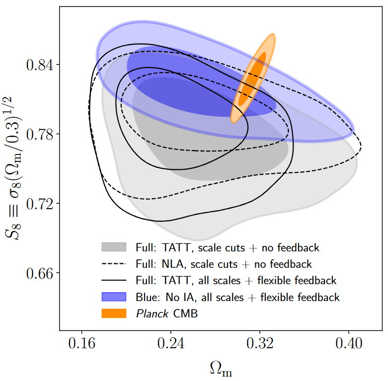
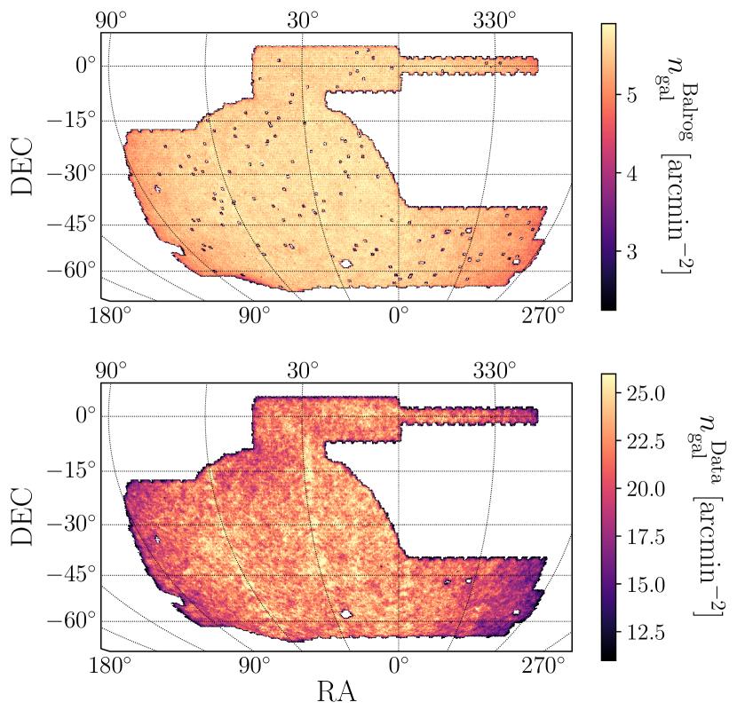
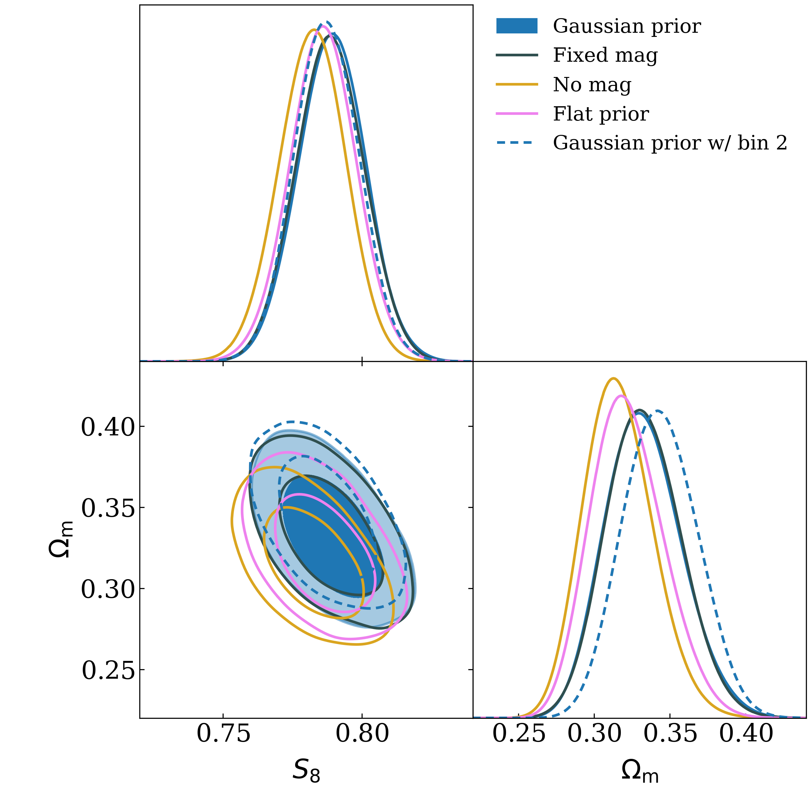
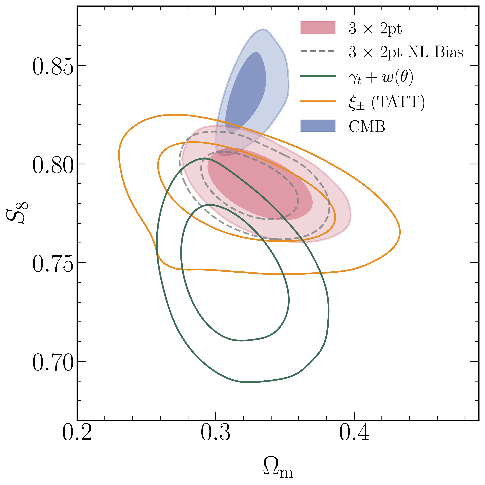

<!--* Table of Contents
{:toc}

 -->

I am involved in the **weak lensing** analyses effort of the Dark Energy Survey ([DES]), the leading lensing experiment to date. DES has completed a six-year observing program, covering about one quarter of the southern sky and imaging over 200 million galaxies in five broadband filters. By observing how light from distant galaxies gets slightly distorted by intervening massive structures, we can map the matter distribution of our Universe and study its geometry and evolution over time. To distinguish between different models of our Universe, we need very accurate measurements, which requires carefully addressing various systematic effects. My work focuses on exploring and mitigating some of these effects, such as **intrinsic alignments** and **magnification**.

I am also working on the preparation of one of the most ambitious high-precision full-sky galaxy surveys of this decade, the Legacy Survey of Space and Time ([LSST]), which will provide a sample of over 3 billion galaxies for lensing studies and unprecedented precision in constraining the cosmological model.

## Publications

The full list of my papers is available on [ADS]. Below are the publications for which I was the lead author or made significant contributions.

---

#### The IA Guide: A Breakdown of Intrinsic Alignment Formalisms

C. Lamman, E. Tsaprazi, J. Shi, N. Šarčević, S. Pyne, E. Legnani, T. Ferreira  
The Open Journal of Astrophysics, Feb 2023

A condensed overview of common notations and concepts relevant for describing the intrinsic alignment (IA) of galaxies.  

<a href="https://doi.org/10.21105/astro.2309.08605" class="button" target="_blank" rel="noopener noreferrer">Paper</a>
<a href="https://arxiv.org/pdf/2309.08605v2" class="button" target="_blank" rel="noopener noreferrer">📄 PDF</a>

---

#### Dark Energy Survey Year 3: Blue Shear

J. McCullough, A. Amon, E. Legnani, D. Gruen, et al.  
Physical Review D, May 2026

A cosmic shear reanalysis of the DES Y3 data limited to a pure sample of blue, star-forming galaxies, which is expected to be less impacted by IA.  

<a href="https://doi.org/10.1103/wmp3-qc3p" class="button" target="_blank" rel="noopener noreferrer">Paper</a>
<a href="https://arxiv.org/pdf/2410.22272" class="button" target="_blank" rel="noopener noreferrer">📄 PDF</a>
<a href="https://jamiemccullough.github.io/data/blueshear/" class="button" target="_blank" rel="noopener noreferrer">Data</a>

---

#### Dark Energy Survey Year 6 Results: Synthetic-Source Injection Across the Full Survey Using Balrog

D. Anbajagane, M. Tabbutt, et al. (incl. E. Legnani)  
The Open Journal of Astrophysics, May 2025

A catalog of 146 million synthetic injections across the DES 5000 deg² footprint to characterize image processing and support DES Y6 cosmology analyses.  

<a href="https://doi.org/10.33232/001c.138627" class="button" target="_blank" rel="noopener noreferrer">Paper</a>
<a href="https://arxiv.org/pdf/2501.05683v3" class="button" target="_blank" rel="noopener noreferrer">📄 PDF</a>

---

#### Dark Energy Survey Year 6 Results: Magnification Modeling and its Impact on Galaxy Clustering and Galaxy-Galaxy Lensing Cosmology

E. Legnani, et al.  
Physical Review D, June 2026

Analysis of the impact of gravitational lensing magnification on DES Y6 galaxy clustering and galaxy–galaxy lensing measurements, using synthetic source injection to model magnification bias and ensure unbiased cosmological constraints.  

<a href="https://doi.org/10.1103/rpdb-7zyn" class="button" target="_blank" rel="noopener noreferrer">Paper</a>
<a href="https://arxiv.org/pdf/2601.14833" class="button" target="_blank" rel="noopener noreferrer">📄 PDF</a>

---

#### Dark Energy Survey Year 6 Results: Cosmological Constraints from Galaxy Clustering and Weak Lensing

DES Collaboration (incl. E. Legnani)  
Physical Review D, Nov 2026

Combined cosmological constraints from the full six-year DES dataset, using galaxy clustering, galaxy-galaxy lensing and cosmic shear (3x2pt) to constrain the matter density and clustering amplitude.

<a href="https://doi.org/10.1103/nnlj-gyr2" class="button" target="_blank" rel="noopener noreferrer">Paper</a>
<a href="https://arxiv.org/pdf/2601.14559" class="button" target="_blank" rel="noopener noreferrer">📄 PDF</a>
<a href="https://des.ncsa.illinois.edu/releases/y6a2/Y6key-products" class="button" target="_blank" rel="noopener noreferrer">Data</a>

---

[ADS]: https://ui.adsabs.harvard.edu/search/fq=%7B!type%3Daqp%20v%3D%24fq_database%7D&fq_database=(database%3Aastronomy%20OR%20database%3Aphysics)&q=elisa%20legnani&sort=date%20desc%2C%20bibcode%20desc&p_=0
[DES]: https://www.darkenergysurvey.org/
[LSST]: https://lsstdesc.org/